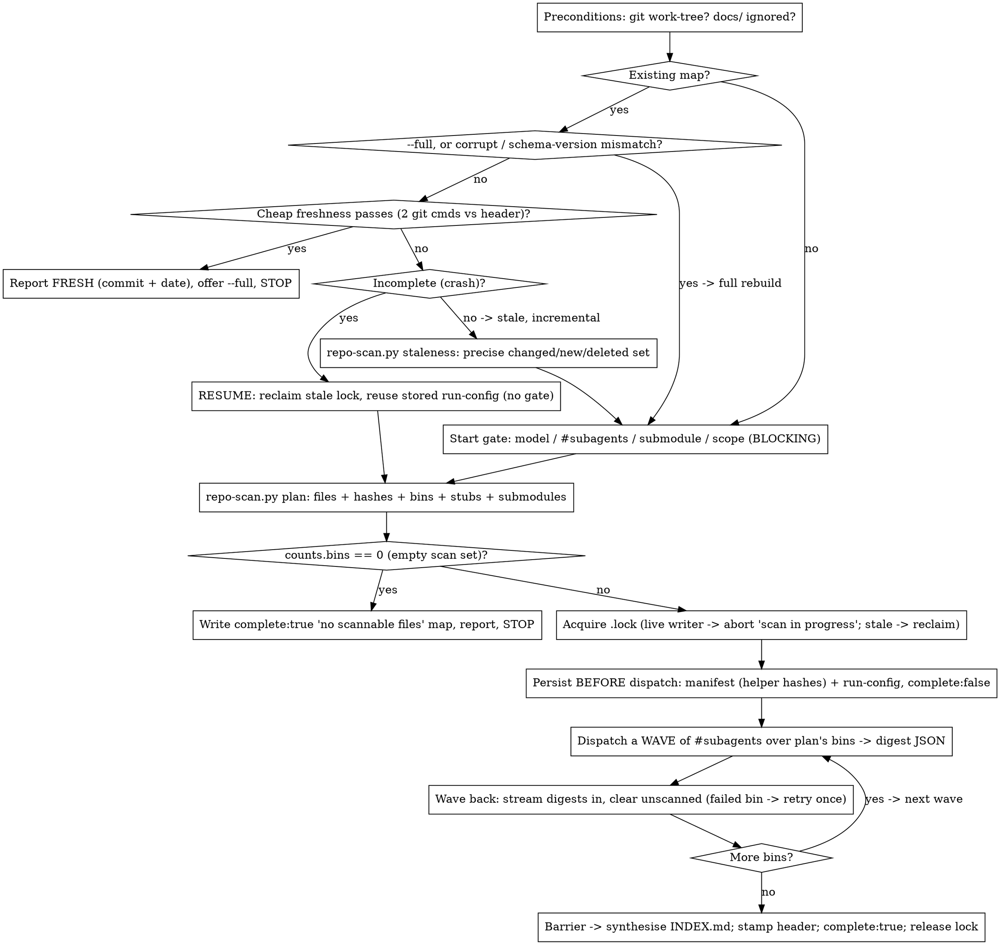

# Grill Repo

**Scan a git repo once, fan the read-out across bounded waves of fresh-context subagents, and persist a
navigable repo map — a per-file digest (constants, functions, classes, each with a one-line logic note)
plus a synthesised overview (purpose, architecture, entry points, dependencies, index) — at a stable,
gitignored path.** All the deterministic plumbing — enumerate, `git hash-object` fingerprint, classify
binary/symlink, bin-pack, staleness-diff — is delegated to the bundled helper `scripts/repo-scan.py`,
which emits JSON and writes nothing; the **semantic digests** are the job of LLM scanning subagents, and
**you** (the orchestrator) synthesise the overview and own every write. Each file carries a `git
hash-object` fingerprint and the map records the commit/branch/date it was built at, so any later session
or dispatched subagent can tell in two git commands whether the map is fresh and read it INSTEAD of
re-reading the tree. The map persists incrementally so an interrupted scan resumes; re-runs are
incremental — only changed/new files are re-read.

**Core principle:** the orchestrator (you) is the **only stateful actor** and the **only writer**. The
**helper owns the deterministic plumbing** — it is the single source of truth for enumeration,
fingerprinting, classification, bin-packing, and the staleness diff, and for the constants those use;
you call it and consume its JSON rather than re-deriving any of it by hand. **Scanning subagents** are
fresh-context, read their bin's files **read-only**, and return ONLY the strict JSON digest. Everything
durable — the **manifest** of authoritative `git hash-object` fingerprints (straight from the helper),
the **run-config**, and the streamed digests — is written by **you**, BEFORE dispatch and after every
wave, so the map is crash-resumable and the **manifest hash is the single source of truth** (a subagent's
returned hash is advisory only). The job is to **map, not to grade** — no quality verdicts, no
bug-hunting. The two worst failures are **fabricating a digest for a file a subagent never actually read**
(or reading a failed/garbage return as "empty"), and **trusting a stale map because the cheap freshness
check was skipped**. The skill is **self-contained** — it dispatches plain subagents but **invokes or
hands off to no other skill** — and it **never touches version control** (its files all live under the
gitignored `docs/` tree).

## When to use
- You want a repo mapped so future sessions and dispatched subagents read a digest instead of re-scanning
  the tree — saving time and tokens.
- You want the map **persisted, fingerprinted, incrementally re-scanned, and crash-resumable**.
- You want a **cheap freshness check** so consumers skip re-reading files that haven't drifted.

**Not for:** grading / reviewing / auditing code quality — it **maps, it does not judge** (use a review
skill); committing or sharing the map — it's a **local cache only** (gitignored; it does not travel to
fresh clones, teammates, or CI); AST/ctags/tree-sitter tooling — structure is extracted by an **LLM reading
files**; injecting markers/fingerprints **into source files** (it never writes into your code); a **non-git**
working tree — git is a **hard v1 precondition**; **concurrent writers** — a single live map writer at a
time (the `.lock`); **deep-indexing the third-party submodule by default** — that's opt-in only.

## The flow



## The helper — `scripts/repo-scan.py`
It ships **beside this skill** at `scripts/repo-scan.py` (resolve its path from the skill's own directory).
Stdlib-only Python 3, deterministic, **read-only — it writes no map files**. Two subcommands; both emit
JSON to stdout and exit non-zero with a clear message if the target is not a git repo.
- `plan` — enumerate + classify + fingerprint + bin-pack → `{repo, files, bins, stubs, submodules, counts}`.
- `staleness` — diff the current tree vs a saved manifest → `{cheap_fresh, repo, changed, new, deleted, unchanged}`.

Below, `python3 scripts/repo-scan.py …` is shorthand: run the bundled script with `--root <repo-to-scan>`
(defaults to the cwd). The orchestrator consumes the JSON; it never re-implements the plumbing by hand.

## Constants
The deterministic-plumbing constants are **owned by the helper** — it is where they are enforced. The
values below are cited for reference and are tuned via `plan`/`staleness` **flags**, never re-implemented:
- **Bin ceiling:** ~64 KB of source text **OR** 15 files per bin, whichever first (`--bin-bytes 65536`,
  `--bin-files 15`). A single file over the byte ceiling gets its own dedicated bin.
- **Stub list (no LLM read):** `.png .jpg .jpeg .gif .svg .ico .pdf .zip .tar .gz .woff .woff2 .ttf .otf
  .mp4 .mp3 .bin` + lockfiles (`package-lock.json`, `yarn.lock`, `pnpm-lock.yaml`, `poetry.lock`,
  `Cargo.lock`, …) — the helper classifies these (and git-reported / null-byte binaries, and symlinks) as
  non-source `stubs`.

These are the **SKILL.md's own** conventions (the LLM scanners' and orchestrator's job, not the helper's):
- **#subagents:** default **5**, clamped to **[1, 16]** — this is the **wave width** (concurrency), not the
  bin count (bins come from the helper and scale with total size).
- **Per-file digest depth:** 1–2-line purpose; constants (name + type/value); functions (signature + a
  **one-line** logic note); classes (fields + methods, one line each); key imports. Lean & navigational.
- **Large-file chunking:** files > ~1500 lines are processed section-by-section.
- **Map schema-version:** `1`. A map whose recorded schema-version differs from this forces a full rebuild.

## Digest schema — the subagent contract (pinned)
Each scanning subagent returns, per file, exactly one JSON object of this shape:

```json
{
  "path": "rel/path.py",
  "lang": "python",
  "loc": 142,
  "hash": "<advisory; orchestrator's manifest hash is authoritative>",
  "purpose": "1–2 line file role",
  "constants": [{"name": "DEFAULT_DPI", "type_or_value": "int = 200"}],
  "functions": [{"sig": "audit(path) -> Report", "logic": "open docx, run CHECKS, collect violations"}],
  "classes": [{"name": "Report", "fields": "violations", "methods": [{"sig": ".summary()", "logic": "format a table"}]}],
  "imports": ["python-docx"],
  "stub": false,        // true → binary/data/lockfile/symlink, not read
  "elided": false,      // true → omitted by a depth limit / skip-glob
  "unscanned": false    // true → not yet scanned, or subagent failed (hash still recorded)
}
```

## Process

### 1. Preconditions — fail fast, no side effects (S1)
- Validate with **zero writes**. If `git rev-parse --is-inside-work-tree` is not true → **STOP** with a
  clear "grill-repo needs a git working tree" message and write **nothing**. *(No non-git fallback in v1 — a
  content-sha256 + mtime mode for non-git dirs is a possible later enhancement, explicitly out of scope.)*
  The helper also hard-requires git (it exits non-zero), but you check first so nothing is dispatched.
- Run `git check-ignore docs/`. A global gitignore counts. If `docs/` is genuinely **not** ignored, **WARN**
  — the "never committed" guarantee can't be honoured. **Warn only:** do not auto-remediate (never edit
  `.gitignore`) and never `git add`/commit.
- Only after preconditions pass, route the run (Step 2).

### 2. Decide the run — fresh-skip · resume · scan
Read `docs/grill-repo/manifest.json` + `INDEX.md` if present; choose the branch **before** any gate or scan:
- **Fresh complete map (no `--full`)** — the **cheap freshness check** (Step 11, ≤ 2 git commands, no helper
  call) passes → do **NOT** re-scan; report the map is fresh (commit + ISO date), offer a `--full` refresh,
  then STOP. *(With `--full`, skip this fast-path → full rebuild below.)* (S17)
- **Crash-incomplete map** — header `complete:false` with `unscanned` entries → **RESUME** (Step 12):
  reclaim any **stale `.lock`**, reuse the **stored run-config** to dispatch identically **without
  re-asking**, scan only `unscanned` + since-changed files. (S18)
- **Missing / corrupt / schema-version ≠ current, or `--full`** → **full rebuild** (Step 12): discard any
  carried digests, go to the gate. (S16)
- **Stale complete map, no `--full`** → **incremental** (the default mode): the precise check (Step 11) via
  `repo-scan.py staleness` yields the changed/new/deleted set; go to the gate, then re-scan only that set. (S15)

### 3. Start gate — BLOCKING (ask, then STOP and wait) (S2, S3)
Reached only when a scan is actually needed and this is **not** a config-reusing resume. Emit the questions
below, **end your turn, and wait** — never read or scan a file while waiting (**silence ≠ consent**).
Defaults apply **only** on an explicit "just go" / hand-over. Each answer maps directly to a `plan` flag:
- **Model** — offer the harness tiers **most-capable / balanced / fast** (no hardcoded names); **default
  `balanced`**. The user may instead **name a concrete model**; a named model **not in the harness roster is
  rejected and re-asked**. Map the chosen tier/model to the dispatch model used for **every** scanning
  subagent. *(Tier→model mapping is intentionally non-enumerable, so the exact model a tier resolves to is
  not asserted here.)* (Not a helper flag — it governs subagent dispatch.)
- **#subagents** — the **wave width** (concurrency). **Default 5**, **clamped to [1, 16]**; a non-integer or
  value < 1 is **rejected and re-asked**. (Not a helper flag — it governs how many bins run at once.)
- **Walk submodule?** — default **no** → `--submodule blackbox`; opt-in → `--submodule walk` (the `ponytail`
  submodule is otherwise a black box — Step 4).
- **Scope limits** — default **none**; optionally **depth caps** per folder → one `--depth DIR=N` each, and/or
  **skip-globs** for large vendored/generated trees → one `--skip GLOB` each (Step 4).
- Store the chosen **run-config** (model, #subagents, and the exact `plan` flags) in the manifest (Step 5) so
  a later resume reuses it verbatim.
- On an **incremental** re-run the gate is **re-shown unless** the knobs were passed as args.

### 4. Build the scan set — call `repo-scan.py plan` (S4–S7)
Run the helper once; it does all of enumeration, classification, fingerprinting, submodule handling, eliding,
and bin-packing:

```
python3 scripts/repo-scan.py plan --root <repo> \
  --submodule {blackbox|walk} \
  [--depth DIR=N ...] [--skip GLOB ...] \
  [--bin-bytes 65536] [--bin-files 15]
```

Consume its stdout JSON:
- `repo` → `{commit, branch, dirty}` — the stamp for the header (Step 10).
- `files` → `[{path, size, hash, kind, elided}]` (a symlink entry also carries `target`) — the **whole
  scan set**, every entry fingerprinted with `git hash-object`. This **is your manifest** (Step 5). `kind` ∈
  `source` / `binary` / `symlink`.
- `bins` → `[[path, …], …]` — source files **already ceiling-packed**, directory-contiguous, big files
  isolated. **Do not re-pack** (Step 6).
- `stubs` → `[{path, kind, size, hash}]` — symlink entries **additionally carry `target`** (the `readlink`
  value) — the binary/symlink files recorded with **no LLM read** (S4): binaries (git-reported,
  null-byte-sniffed untracked, or on the stub list) and **symlinks (the `target` field records the link
  target, never followed)** → map entries with `stub:true`.
- `submodules` → `[{name, url, commit, walked}]` — the `ponytail` submodule as ONE black-box entry
  (name/URL/pinned commit) when `--submodule blackbox` (S4); with `--submodule walk` (S5) its files are
  already enumerated into `files`/`bins` (fingerprinted off the submodule's own commit) and `walked:true`,
  and the pinned commit is recorded for staleness.
- `counts` → `{source, binary, symlink, elided, bins}`. Files matched by `--depth`/`--skip` are in `files`
  with `elided:true`, excluded from `bins` (S6) → map entries with `elided:true`; note the omission
  ("+N deeper/skipped files elided") so coverage stays honest.

**Empty scan set (S7):** if `counts.bins == 0` (empty repo, or everything ignored/binary/skipped/elided) →
do **NOT** fan out; write a valid **`complete:true`** map with a header, any stubs/submodule entries, and a
"no scannable files" note, then report. A non-git / helper error is a **hard stop** (Step 1 already guarded
it; treat any non-zero helper exit as fatal and write nothing further).

### 5. Persist BEFORE dispatch — the manifest is the single source of truth (persistence model)
- **Acquire the single-writer lock FIRST — before any map write.** Claim `docs/grill-repo/.lock`, recording
  the writer's identity + start time. If a **live** writer already holds it → **ABORT** with "scan already
  in progress" and write **nothing**. If the lock is **stale** (writer not live, or the map is still
  `complete:false` from a crash) or absent → **acquire/reclaim** it (resume, Step 12). Only with the lock
  held do you perform the first manifest write below; it is **released on clean exit** (Step 10).
- Before dispatching **any** subagent, persist the machine-readable state at `docs/grill-repo/manifest.json`:
  the **header** (commit/branch/ISO date/dirty-at-scan/`complete:false`/schema-version), the **run-config**
  (model, #subagents, and the exact `plan` flags), and the **`files`** array from `plan` **verbatim** (path →
  authoritative `git hash-object` hash). The helper's `staleness --manifest` reads this file's `files`
  directly. Seed every source entry `unscanned:true`, every stub `stub:true`, every elided file `elided:true`.
- The **manifest hash is authoritative**; a subagent's returned `hash` is **advisory only** — so a
  dirty-built or partial map **self-heals file-by-file** at the precise freshness check (Step 11).
- Because the manifest exists **before** dispatch, **even an interrupted first scan resumes** (Step 12)
  rather than restarting.

### 6. Fan-out — wave dispatch over the helper's bins, streamed writes (S8)
- The bins are `plan`'s `bins` — already bounded by the ceiling, so **bin count scales with total size S, not
  with #subagents**. You do not size or pack them.
- Dispatch bins in **waves of `#subagents` concurrent at a time** until all bins are done. **Every** scanning
  subagent runs on the **gate-chosen tier/model** and reads **only its bin's files, read-only**, returning the
  pinned digest array (brief below).
- **After each wave**, stream the returned digests into the map, replacing those files' `unscanned`
  placeholders and updating their state in `manifest.json`. **Barrier:** wait for **all** bins before
  synthesis (Step 9). *(v1 has no per-wave progress surface — failures are reported post-run, Step 7.)*

### 7. Subagent failure handling (S9)
- A bin that times out, errors, or returns **malformed / partial** JSON is **retried once** (fresh).
- If it **still** fails, its files stay marked **`unscanned`** (fingerprint already recorded; any prior
  digest carried forward) and the failure is **reported to the user**.
- **Malformed output is never read as "empty" and never fabricated** — an unread file gets **no** invented
  digest.

### 8. Per-file digest depth — lean & navigational (S10)
- Each entry follows the **pinned schema**: path, lang, loc, hash, a **1–2-line purpose**, **constants**
  (name + type/value), **functions** (signature + a **one-line** logic note each), **classes** (fields +
  methods, **one line** each), key **imports**.
- Symbols and signatures are **read from the actual code, never guessed**. Files over **~1500 lines** are
  processed **section-by-section** (Constants). **Non-code** files (config/docs/data) get **purpose + key
  sections** instead of functions/classes.
- It is a **navigation aid, not a review** — no quality grades, no bug-hunting.

### 9. Synthesise the overview — INDEX.md (S11)
- After the barrier, compose `INDEX.md`: the **header** (Step 10), a **one-paragraph repo purpose**, an
  **architecture / module-boundary map**, **entry points**, **key external deps + submodules**,
  **cross-cutting conventions**, and a **navigable file→one-liner index**.
- The **index table mirrors the fingerprint manifest** (path → hash) for human navigation; `manifest.json`
  holds the byte-exact copy the helper diffs. Set the header **`complete:true`** (in both `INDEX.md` and
  `manifest.json`). *(On very large trees the barrier-merge of all digests to compose INDEX.md is unbounded
  in v1 — sharding the manifest per directory, so a consumer loads only its slice, is the noted later
  mitigation.)*

### 10. Output, stamping, freshness block & single-writer lock (S12)
- Write `docs/grill-repo/INDEX.md` + `docs/grill-repo/manifest.json` + per-directory shards, updated **in
  place** at the stable path (no date in the filename). A shard's filename is the directory's repo-relative
  path with separators **sanitised to `__`** (`ponytail/skills` → `files/ponytail__skills.md`; root files →
  `files/_root.md`).
- The **header** records: commit SHA, branch, ISO scan date, clean/dirty-at-scan, map **schema-version**,
  the **`complete`** flag, and the **run-config**. **Branch is display-only** — a branch change alone does
  **not** mark the map stale (commit SHA is the authoritative key); surface it as an advisory note at most.
- Embed a **literal, verbatim Freshness block** in the header stating the exact check (Step 11) **inline**,
  so any reader finds the predicate without this doc.
- The single-writer lockfile `docs/grill-repo/.lock` was **acquired at the start of the write phase**
  (Step 5, before the first manifest write), recording the writer's identity + start time; on **clean exit**
  here (the run completes, or aborts cleanly) it is **released**. A **live** concurrent writer makes a second
  run **abort** ("scan already in progress") at acquisition (Step 5); a **stale** lock (writer not live, or
  map still `complete:false`) is **reclaimed** by the next run (Step 12) so resume is never blocked by an
  orphaned lock. The whole `docs/grill-repo/` tree is **gitignored** (Step 1).

### 11. Freshness — cheap, then precise (S13, S14)
This is the predicate consumers and grill-repo itself run; it is also embedded **verbatim** in the header
(Step 10), so any reader finds it inline.
- **Cheap path (you, ≤ 2 git commands, no helper, no file reads):** trust the **entire** map **iff** header
  `complete == true` **AND** recorded `dirty-at-scan == false` **AND** `git rev-parse HEAD` == the recorded
  commit **AND** the current tree is clean. Do this yourself against the header — do **not** invoke the
  helper for it (the helper would hash every file). Otherwise the cheap path is **disallowed** → go precise.
- **Precise path (the helper):** call

  ```
  python3 scripts/repo-scan.py staleness --root <repo> \
    --manifest docs/grill-repo/manifest.json \
    --recorded-commit <header.commit> \
    --recorded-dirty {true|false} \
    --complete {true|false} \
    --submodule {blackbox|walk} [--depth DIR=N ...] [--skip GLOB ...]
  ```

  Pass the **same scope flags** recorded in the run-config so the compared set matches the original `plan`.
  Consume `{cheap_fresh, repo, changed, new, deleted, unchanged}` — the helper recomputes `git hash-object`
  per file and diffs against the manifest (the single authoritative hash source; it self-heals a dirty/partial
  map file-by-file, and supports a one-file lookup though it is framed as a whole-set recompute). A **rename**
  surfaces as **delete (old path) + add (new path)**; its digest is **rebuilt for the new path** in v1, not
  carried across. (`cheap_fresh` mirrors the cheap predicate as a cross-check; the cheap path proper never
  reaches this call.)

### 12. Re-scan modes — incremental · full · resume (S15, S16, S18)
- **Incremental (default):** drive the changed set from `repo-scan.py staleness` (Step 11 precise) →
  `changed` / `new` / `deleted` / `unchanged`. Call `repo-scan.py plan` (same scope flags) for the **fresh
  fingerprints** (the new manifest) and the **bins**. The to-scan set = `changed ∪ new ∪` any still-`unscanned`
  entries; dispatch only the `plan` bins whose members intersect it (restrict each dispatched bin to its
  to-scan members), wave-dispatched per Step 6. **Carry unchanged digests forward untouched**; **prune**
  deleted files' entries; re-synthesise `INDEX.md` and restamp the header from the fresh `plan.repo`.
- **Full (`--full`, or missing / corrupt / schema-version mismatch):** **discard** carried-forward digests
  and rebuild the whole map from scratch (Steps 4–10). `--incremental` is the default mode.
- **Resume (crash):** an interrupted scan left `complete:false` + `unscanned` entries (and maybe a stale
  `.lock`). **Reclaim** the lock, read the **stored run-config** to dispatch identically **without
  re-asking**, re-run `plan` (stored flags) for fresh bins/fingerprints and `staleness` for since-changed
  files, scan only `unscanned` + since-changed, and finish — **re-paying nothing** for already-digested
  files. The pre-dispatch manifest (Step 5) makes even a first scan resumable.

### 13. Consumer wiring — the map is meant to be READ (S19, reference only)
- A companion change wires the **freshness predicate inline** into agent onboarding prompts so that, before
  scanning a repo, an agent checks `docs/grill-repo/INDEX.md`, treats it fresh by the Step 11 cheap predicate
  (else recomputes `git hash-object` per file vs the manifest — i.e. `repo-scan.py staleness`), reads **only**
  missing/stale entries, and otherwise considers running `grill-repo`; and so that **dispatched subagents
  needing repo context get the map path + that predicate in their brief** (fresh subagents don't inherit
  global rules). Those edits take effect only once the user **deploys** them to their live config — the
  deploy stays the user's existing process. *(Authoring those prompt files is a separate task; this skill only
  relies on the map existing and being checked.)*

## Scanning subagent brief (paste into each bin dispatch)

Each scanner is fresh-context, self-contained, **read-only**, and runs on the gate-chosen model; a
malformed/failed return is retried once (Step 7). If any input is missing, **do not dispatch**.

```
Scan THIS bin of files and return a digest for each. You are one of several fresh, READ-ONLY scanners.

INPUT: bin file list — read each, in full; do NOT read or reference anything outside this list: {files}.

For EACH file, READ the actual code/text and emit ONE JSON digest object in the pinned schema:
- path, lang, loc (line count), purpose (1–2 lines), and `hash` (advisory — give your best value; the
  orchestrator's manifest hash is authoritative, so don't agonise over it).
- constants: name + type_or_value. functions: signature + a ONE-line logic note each. classes: fields +
  methods (each a one-line note). imports: the key ones only.
- Read every symbol/signature from the REAL code — NEVER guess. A file over ~1500 lines: process it
  section by section so nothing is skipped.
- Non-code (config / docs / data): give purpose + key sections instead of functions/classes.
- If a file is unexpectedly binary / data / a symlink: set "stub": true (note the symlink target) and do
  not read it. Set "elided": false and "unscanned": false on everything you actually digest.
- MAP only — do NOT grade, review, rate, or hunt bugs. Do NOT edit any file, run git, or ask anything.

Return ONLY a JSON array of digest objects in the pinned schema — no prose, no markdown fence, nothing else.
```

## Red flags — you're drifting

- About to **re-implement** enumeration / `git hash-object` / classification / bin-packing / the staleness
  diff **by hand** → **NO.** The helper `scripts/repo-scan.py` owns that plumbing and the constants behind it;
  call it and consume its JSON. Hand-rolled plumbing drifts from the manifest the helper diffs against.
- Calling `repo-scan.py staleness` (or any per-file hashing) for the **cheap** freshness check → no. The
  cheap path is **≤ 2 git commands against the header**; the helper is only for the **precise** diff once the
  cheap path is disallowed.
- About to **fabricate a digest** for a file a subagent never read, or read a **failed/garbage return as
  "empty"** → **NO.** Retry once; if it still fails, mark the files `unscanned` and report. An unread file
  gets no invented symbols.
- Trusting a subagent's returned **`hash`** over the manifest → no. The helper's `git hash-object` manifest is
  the **single source of truth** — it's what self-heals a dirty/partial map.
- **Dispatching scanners before** writing the manifest + run-config → no. Persist first (`complete:false`)
  so a crash **resumes** instead of restarting from zero.
- Sizing bins by **#subagents** → no. Bins come from the helper, sized by the **ceiling** and scaling with
  total size S; `#subagents` is only the **wave width**.
- Passing **different scope flags** to `staleness` than the recorded run-config used for `plan` → no. The
  compared set must match, or the diff is meaningless.
- **Scanning before the blocking gate is answered** → no. Emit model / #subagents / submodule / scope, end
  your turn, wait (silence ≠ consent). Only a **config-reusing resume** skips the gate.
- **Re-scanning a fresh map** → no. If the cheap check passes, report fresh (commit + date) and offer
  `--full`; don't re-read a single file.
- Reading **`docs/grill-repo/` / node_modules / gitignored** paths into the scan → no. The helper already
  excludes them (`ls-files` + `--others --exclude-standard`); don't add them back.
- **Following a symlink** or **LLM-reading a binary / lockfile** → no. The helper stubs them (target noted);
  leave them stubbed.
- **Walking the submodule by default** → no. Black box (`--submodule blackbox`) unless the gate said walk-in.
- **Grading / reviewing / bug-hunting** the code → no. grill-repo maps; it does not judge.
- **Committing the map** or **editing `.gitignore`** to silence the ignore warning → no. Local cache,
  gitignored; warn-only, never `git add`/commit, never write into source files.
- **Holding the whole scan in one context** and writing the digests yourself → no. Fresh-context subagents
  read; you orchestrate, barrier, and persist.

## Common rationalizations

| Excuse | Reality |
|--------|---------|
| "I'll just enumerate and hash the files myself in the skill — it's a few git commands." | The helper (`scripts/repo-scan.py`) is the deterministic plumbing — enumerate, fingerprint, classify, bin-pack, staleness-diff — and the single source of truth for those constants. Hand-rolling it drifts from the manifest it diffs against. Call it; consume its JSON. |
| "I'll run `staleness` to check if the map is fresh." | Only for the **precise** path. The **cheap** check is ≤ 2 git commands against the header (complete + clean @ HEAD + built clean) with **no** file hashing. `staleness` re-hashes the tree — reserve it for when the cheap path is disallowed. |
| "The subagent timed out but I roughly know the file — I'll fill the digest in." | Never fabricate. A failed bin retries once; if it still fails the files stay `unscanned` (hash still recorded) and you report it. An unread file gets no invented digest. |
| "The subagent returned a hash, so I'll trust it as the fingerprint." | Its hash is **advisory**. The helper's `git hash-object` manifest is the single source of truth — that's what self-heals a dirty or partial map file-by-file. |
| "I'll dispatch the scanners first and write the manifest once they're back." | Persist BEFORE dispatch (manifest + run-config, `complete:false`). That's what makes an interrupted scan resume instead of restarting. |
| "5 subagents, so 5 bins." | Bins come from the helper, sized by the ceiling (~64 KB / 15 files), so bin count scales with repo size; `#subagents` is only how many run at once per wave. |
| "The map's a few commits old but probably fine — I'll trust it." | Run the check. The cheap path trusts the map only if complete AND clean AND HEAD matches AND it was built clean; otherwise `repo-scan.py staleness` diffs per file and you re-read only what drifted. |
| "Map exists — let me re-scan to be safe." | If the cheap check passes the map is fresh: report it (commit + date) and offer `--full`. Re-reading a fresh tree is the exact waste this skill removes. |
| "It's faster to read every file myself in one context." | The orchestrator is the only stateful actor; scanning is fan-out across fresh-context, read-only subagents. One context can't hold a real repo and won't resume after a crash. |
| "`docs/` isn't ignored — I'll add it to `.gitignore` real quick." | Warn-only. grill-repo never edits `.gitignore` and never commits; the map is a local cache and the user owns their ignore rules. |
| "The submodule's right there — I'll just index it too." | Black box by default (name / URL / pinned commit via `--submodule blackbox`). Walking it is opt-in at the gate — third-party internals aren't yours to index unasked. |
| "A binary / lockfile — I'll skim it for completeness." | The helper already stubbed it: path / type / size / hash, no LLM read. Same for symlinks (target noted, never followed). The digest is for source you can navigate. |
| "While I'm reading, I'll flag the dodgy code too." | grill-repo maps, it doesn't grade. No reviews, no bug-hunts — that's a different skill. |
| "User's in a hurry — I'll pick balanced and start scanning." | The gate is blocking even though `balanced` is the default: emit model / #subagents / submodule / scope, end your turn, wait. Only a config-reusing resume skips it. |
